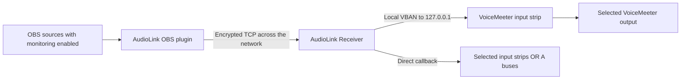

# Elka AudioLink

Send the OBS headphone / monitor mix to another Windows PC over an encrypted TCP
connection. The receiver delivers it through local VBAN or directly through
VoiceMeeter's audio callback.

**Receiver 0.2.0 preview · OBS plugin 0.1.1 · Windows x64 · OBS 31.1.1 or later**

**[Download receiver 0.2.0](https://github.com/torment78/Elka.AudioLink/releases/tag/v0.2.0)**
· [OBS plugin 0.1.1](https://github.com/torment78/Elka.AudioLink/releases/tag/v0.1.1)
· [Callback setup](docs/CALLBACK.md)
· [First test and troubleshooting](docs/TESTING.md)

## What it is for

AudioLink carries the OBS monitor mix to a second PC running VoiceMeeter. It is
useful for a return feed, a listening mix, or a setup where sending VBAN directly
across the network is unreliable. The OBS plugin sends audio over TLS/TCP; the
receiver delivers audio to VoiceMeeter on the same PC. Callback mode needs no local
VBAN stream or UDP audio port.

Windows networking and firewall rules still apply. AudioLink changes the audio
transport between the PCs; it cannot bypass the operating system or guarantee
that a particular VoiceMeeter configuration will receive audio. One sender pairs
with one receiver in this preview.

AudioLink uses the same source monitoring choices as VBAN Stream's return:
**Monitor Only** and **Monitor and Output** contribute; **Monitor Off** does not.
Source filters and fader gains are included. Stereo PCM 24-bit is preserved at the
OBS sample rate. There is no lossy codec, virtual cable, or virtual network adapter.

## What to install

Both PCs need Windows 10/11 x64 and a reachable network connection. Start on the
same LAN for the first test. Install OBS and VoiceMeeter separately as needed.

| PC / purpose | Download from the release | What it does |
| --- | --- | --- |
| OBS sending PC | [OBS plugin installer](https://github.com/torment78/Elka.AudioLink/releases/download/v0.1.1/elka-audiolink-obs-0.1.1-windows-x64-setup.exe) | Adds **Tools → Elka AudioLink** to OBS. |
| VoiceMeeter receiving PC | [Receiver installer](https://github.com/torment78/Elka.AudioLink/releases/download/v0.2.0/elka-audiolink-receiver-0.2.0-windows-x64-setup.exe) | Delivers through VBAN or Callback. OBS is not needed here. |
| Manual receiver installation | [Receiver ZIP](https://github.com/torment78/Elka.AudioLink/releases/download/v0.2.0/elka-audiolink-receiver-0.2.0-windows-x64-portable.zip) | Contains the complete receiver folder. |

Use the installers for the simplest setup. For the ZIP, keep the entire `receiver`
folder together and run `ElkaAudioLink.exe`. For manual OBS installation, use the
plugin folder from the 0.1.1 release ZIP. GitHub's **Source code** archives
contain source, not the runnable applications.

The preview installers are unsigned. Release downloads include a SHA-256
checksum file. OBS 31.1.1 and 32.2.1 were exercised in local integration tests.

## On the receiving PC

For direct output, select **Callback**, click **Detect**, choose **Input strips**
or **Output buses (A)**, tick the destinations, then press **Start / apply**.
Potato offers In 1–In 8 or A1–A5; Banana offers In 1–In 5 or A1–A3. Select any subset
or all of that category. B buses are excluded. Your existing OBS plugin works unchanged.
See [Callback setup and troubleshooting](docs/CALLBACK.md) for the full instructions.

For the original output path, select the **VBAN** tab and follow these steps:

1. Install **Elka AudioLink Receiver** and open it. OBS is not required on this PC.
2. Leave the TCP port at **45991** and the receive buffer at **40 ms** initially.
3. In VoiceMeeter, turn VBAN on and prepare an incoming stream:
   - Stream name: **AudioLink** (or the name chosen in the receiver).
   - Sender IP: **127.0.0.1**.
   - UDP port: **6980** (or the receiver's local VBAN port).
4. Enable that incoming row, choose its **Destination** input strip, and route that
   strip to the VoiceMeeter output you want to hear. For example, use A1 if A1 is
   already configured for your headphones or speakers.
5. Click **Copy pairing code**. Send that code privately to the OBS operator or
   copy it directly if you operate both PCs. It grants permission to send audio.
6. Close the window to leave the receiver running in the **system tray**. Audio
   continues until you choose **Shut down** from its tray menu.

Once the OBS sender is streaming, right-click **Stream Name** or **IP Address From**
in a VoiceMeeter incoming row and select the detected **AudioLink** stream. This
fills in its identity directly. A detected-stream count alone does not mean a row
is accepting audio: its name, sender IP, and port must match, and the row must be
on. See the [VoiceMeeter manual, Configure VBAN Audio Stream](https://vb-audio.com/Voicemeeter/VoicemeeterBanana_UserManual.pdf).

### Tray controls and meter

Click the AudioLink tray icon to reopen the window, or right-click it for:

- **Open settings** — restore the receiver window.
- **Refresh / reconnect** — restart reception with the last applied settings and
  refresh local addresses. Audio briefly stops while the OBS sender reconnects.
  Unsaved edits in the window are not applied by this action.
- **Shut down** — stop reception and exit completely.

Opening the app again restores the existing receiver. Windows may place its icon
under the hidden-icons arrow. If the system tray is unavailable, closing the
window exits instead of leaving an inaccessible background receiver.

The stereo received-audio meter updates at approximately **60 Hz** while the
window is visible. It shows left/right sample peaks on a dBFS scale, with immediate
attack, smooth fall, and a one-second peak marker. Short peaks between display
updates are retained. Meter refresh pauses while hidden or minimized; audio keeps
flowing. It measures incoming audio before the receive buffer, not VoiceMeeter's
playback level.

To update, choose **Shut down** in the old receiver's tray menu before installing
0.2.0. Pairing and saved VBAN settings are retained. Existing 0.1.0 and 0.1.1 OBS
plugins remain compatible. Switch back to VBAN and press Start / apply at any time.

The receiver sends VBAN to loopback only. **127.0.0.1 belongs in VoiceMeeter's
incoming sender field.** Use the receiving PC's LAN address or hostname in the
OBS plugin when the two applications are on different PCs.

## On the OBS PC

1. Close OBS. Install **Elka AudioLink OBS Plugin** into the OBS root folder
   containing `bin/64bit/obs64.exe`, then reopen OBS.
2. Open **Tools → Elka AudioLink**.
3. Select a nearby receiver and click **Use selected receiver**, or enter its
   IP address / hostname and TCP port manually.
4. Paste the receiver's pairing code, then click **Connect and save**.
5. In OBS **Advanced Audio Properties**, select **Monitor Only** or
   **Monitor and Output** for each source to include. A headphone / monitoring
   button in another OBS interface works when it changes that same OBS setting.
6. Optionally enable **Connect automatically when OBS opens** and save.

Pairing is remembered for your Windows user. The sender reconnects after network
interruptions. Discovery can locate the same paired receiver after a LAN address
change; a discovered name alone never authorizes an audio connection.

## Discovery and connectivity

- Audio uses **TCP 45991** by default, protected by TLS.
- Optional discovery uses small **UDP 45992** broadcast queries and replies. Audio
  does not travel in these discovery packets. No Bonjour or mDNS service is needed.
- Discovery works within a broadcast subnet. Across a reachable VPN, VLAN, or
  routed network, use manual addressing when broadcasts do not cross the router.
- Windows Firewall must allow the receiving helper's selected TCP port. If Windows
  asks, allow it on the trusted network you intend to use. Discovery additionally
  needs UDP 45992. The installers do not disable or modify the firewall.
- There is no hosted relay, NAT traversal service, or automatic internet port
  forwarding. A directly reachable address is required.

## Reading the status

The sender distinguishes connecting, authenticated, and streaming with receiver
acknowledgements. The helper shows received audio level, received packet count,
local output counters, buffer depth, discarded audio, and underruns. Callback mode
shows frames actually added by the callback and VoiceMeeter's sample rate. This
confirms processing, not that a physical output is audible. Older OBS plugins still
mention VBAN in their status text; use the receiver's active-mode label and counters.

**Local VBAN sent means Windows accepted a local UDP packet. It does not confirm
VoiceMeeter received or played it.** Check the VoiceMeeter input meter and listen.

For the first test, follow the [short test guide](docs/TESTING.md). It separates
connection problems, an empty OBS monitor mix, incoming-stream selection, and
VoiceMeeter output routing.

Start with the default buffers. Increase the receive buffer if short network
interruptions cause underruns; increase the OBS monitor buffer if source callbacks
arrive late. More buffering adds delay. TCP can stall while retransmitting lost
data. AudioLink drops excess queued audio and reconnects stalled sessions instead
of allowing an unlimited backlog.

In OBS 32.2 and later on Windows, AudioLink follows the return engine's monitoring
mute behavior: the normal program mute may leave monitored audio audible. Use
**Monitor Off** to remove a source reliably. In OBS 31.1.1, program mute is honored.

Do not route the received return back into the monitored OBS mix; that creates an
audio feedback loop.

## Files and privacy

Receiver settings live under `%LOCALAPPDATA%/ElkaSoft/Elka AudioLink`.
Sender settings live in OBS's `plugin_config/elka-audiolink` folder. Pairing secrets
and the receiver private key are protected with Windows DPAPI for the current user.
No accounts, cloud service, recordings, or telemetry are used.

This is a preview. Automated callback tests simulate the VoiceMeeter engine using
its documented API layout. Live callback listening still needs confirmation on the
target PC. Local tests cannot prove that its final output routing is audible.

Build and engineering details: [docs/DEVELOPMENT.md](docs/DEVELOPMENT.md).
License and reused components: [NOTICE.md](NOTICE.md).
